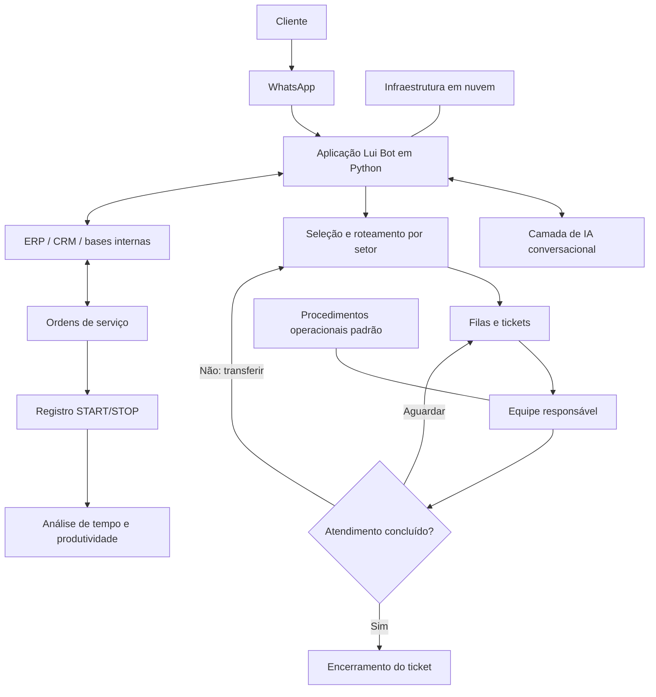

# Lui Bot de Atendimento

**Projeto de automação empresarial com Python, atendimento via WhatsApp, inteligência artificial conversacional e integração de processos operacionais.**

> Case técnico anonimizado para portfólio. O nome da empresa atendida e os dados internos foram omitidos. Este repositório documenta o projeto em nível funcional e arquitetural; não contém o código-fonte original nem credenciais ou dados empresariais.

## Visão geral

O Lui Bot foi desenvolvido aproximadamente três anos antes da publicação deste case para organizar o atendimento ao cliente e conectar a comunicação com os processos internos de uma operação do setor automotivo.

A solução foi desenvolvida em **Python** e combinava um fluxo de atendimento pelo WhatsApp, encaminhamento por departamentos, gestão de tickets, uma camada de IA conversacional, acesso a informações operacionais e recursos de acompanhamento de produtividade.

A implantação também incluiu a adoção de infraestrutura em nuvem e de um sistema de gestão voltado à operação de oficina e manutenção automotiva. O processo completo de implantação levou aproximadamente quatro meses.

## Objetivos do projeto

- Organizar as solicitações recebidas pelo WhatsApp.
- Encaminhar cada conversa ao departamento responsável.
- Permitir transferência, espera e encerramento de tickets.
- Tornar informações operacionais mais acessíveis aos setores autorizados.
- Acompanhar o tempo registrado nas ordens de serviço e nas atividades de manutenção.
- Padronizar rotinas por meio de procedimentos operacionais padrão (POPs).
- Melhorar a visibilidade da operação e apoiar decisões de alocação de trabalho.

## Funcionalidades principais

### 1. Atendimento e roteamento pelo WhatsApp

Quando o cliente enviava uma mensagem, o sistema apresentava opções para identificar o setor desejado e direcionava a solicitação à equipe responsável.

O fluxo de atendimento contemplava:

- seleção do departamento;
- encaminhamento para a equipe responsável;
- transferência para outro setor quando necessário;
- permanência em fila de espera;
- finalização do ticket pelo setor responsável.

### 2. IA conversacional

O sistema incorporava uma camada de inteligência artificial para tornar a interação mais natural e amigável, apoiar orientações durante o atendimento e complementar os fluxos automatizados. O provedor/modelo específico utilizado na implantação original não está confirmado neste registro e, por isso, não é nomeado aqui.

### 3. Integração com informações empresariais

O fluxo operacional se conectava a bases de dados internas e a sistemas utilizados pela empresa, incluindo ERP, CRM e ordens de serviço. As informações apoiavam o atendimento e rotinas relacionadas a clientes, veículos, serviços e atividades administrativas.

Os processos organizados também incluíam emissão de notas fiscais e atendimento a seguradoras. Os detalhes de conexão e os nomes dos sistemas foram omitidos para preservar informações internas da organização.

### 4. Registro de tempo e produtividade

O projeto incluiu um fluxo de registro de início e pausa/conclusão de atividades, usando operações do tipo **START/STOP**. Isso permitia acompanhar o tempo associado aos serviços executados em cada veículo e analisar a utilização da capacidade operacional.

Os registros ajudavam a identificar períodos de ociosidade e a melhorar a distribuição e o acompanhamento do trabalho entre áreas como mecânica, elétrica, funilaria e pintura. Não são publicados percentuais de ganho ou indicadores numéricos porque não há uma série histórica validada neste documento.

### 5. Nuvem, sistema de gestão e padronização

A implantação incluiu infraestrutura em nuvem e sistema de gestão voltado à operação automotiva. Também foram organizados procedimentos operacionais padrão para dar mais consistência a rotinas de atendimento, ordens de serviço, faturamento e relacionamento com seguradoras.

## Arquitetura funcional

O diagrama abaixo representa os componentes funcionais descritos neste case, não um diagrama de implantação física detalhado.

## Tecnologias e componentes

**Confirmados no relato do projeto:**

- Python;
- WhatsApp como canal de atendimento;
- camada de inteligência artificial conversacional;
- integração operacional com ERP, CRM, bases internas e ordens de serviço;
- infraestrutura em nuvem;
- fluxos de tickets, departamentos e registro START/STOP.

**Nota sobre n8n:** o n8n **não fez parte da implementação original** descrita neste case. Ele pode ser avaliado como alternativa para uma futura modernização ou para novas integrações, mas não deve ser apresentado como tecnologia usada no projeto original.

## Implantação

A implantação completa levou aproximadamente quatro meses e envolveu a configuração do sistema de gestão, a preparação da infraestrutura em nuvem, a organização dos fluxos de atendimento e a padronização dos procedimentos operacionais.

## Aprendizados e valor profissional

O projeto exigiu combinar desenvolvimento em Python, entendimento de processos de negócio, integração de sistemas, experiência do usuário, gestão de filas de atendimento e mensuração do tempo operacional.

O principal aprendizado foi que a automação gera mais valor quando conecta o atendimento aos sistemas de registro e às rotinas executadas pelas equipes, e não apenas quando responde mensagens automaticamente.

## Privacidade e limites deste case

Este material foi deliberadamente anonimizado. Não inclui:

- nome da empresa atendida;
- dados de clientes, funcionários ou veículos;
- credenciais, tokens ou endpoints privados;
- estrutura real de bancos de dados;
- código-fonte original;
- indicadores quantitativos não documentados.

## Sobre

Case preparado para portfólio profissional de **Thiago Rafael de Souza Gomes**, com foco em desenvolvimento Python, automação de processos, integração de sistemas, inteligência artificial aplicada e transformação digital.
